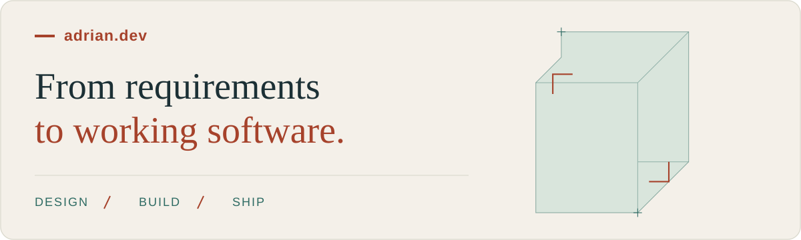

<!-- Publish as README.md in NairAd02/NairAd02, alongside assets/github-profile-banner.svg. -->

# Hi, I'm Adrian Suarez Padrón

**Software Engineer · Full-Stack Development · Applied AI**  
Havana, Cuba

I build web applications with **TypeScript, React, Next.js and NestJS**, taking ideas from client requirements through architecture, implementation, deployment and support. My work spans business platforms, external API integrations and AI features with structured outputs and human review.

[Explore my portfolio](https://adrian-dev-app.vercel.app/en) · [Portfolio en español](https://adrian-dev-app.vercel.app/es) · [Get in touch](mailto:adrian.suarez.alphen@gmail.com)

## Selected work

### Business applications

- **Telepresence Management & Billing** — Co-developed a production platform with another developer, connecting an external API to call-based billing, Redis caching, reporting and deployment pipelines. **NestJS · Next.js · PostgreSQL · Redis**
- **DevOps Fleet Dashboard** — Co-developed an internal Docker fleet dashboard with scheduled cleanup, persistent background jobs, role-based permissions and audit trails. **Next.js · Prisma · PostgreSQL · Docker**
- **[Perfumes del Puro](https://adrian-dev-app.vercel.app/en/projects/perfumes-del-puro)** — Built and launched a storefront, administration panel and API for products, stock and orders; deployed to a VPS with Docker, Nginx and GitHub Actions. **Next.js · NestJS · PostgreSQL**
- **[Item Custody & Intake](https://adrian-dev-app.vercel.app/en/projects/professional-item-custody-intake-platform)** — Delivered an operational platform in approximately 15 days at NTSprint, including barcode scanning, thermal labels and post-launch support. Collaborated on payments and notifications. **Next.js · Supabase**

### Applied AI

- **[TalkFlow](https://adrian-dev-app.vercel.app/en/projects/talkflow)** — Independently designed and built a working demo in one week at NTSprint. Turns recorded conversations into draft customer records and service requests, with source evidence and human review before saving. **AssemblyAI · Groq · Next.js**
- **[NTS Relay](https://adrian-dev-app.vercel.app/en/projects/nts-relay)** — Built a WhatsApp intake platform with AI extraction, explicit confirmation, operator handoff and recoverable background processing. Tested in controlled scenarios; business adoption remains pending. **WhatsApp Cloud API · NestJS · BullMQ**

Explore the [full project collection and technical write-ups](https://adrian-dev-app.vercel.app/en#projects) for architecture, screenshots and my contributions.

## Technologies I work with

| Area | Main tools |
| --- | --- |
| Frontend | TypeScript, JavaScript, React, Next.js, Tailwind CSS |
| Backend & data | Node.js, NestJS, PostgreSQL, Supabase, Prisma, TypeORM, Redis, BullMQ |
| AI & integrations | Vercel AI SDK, Groq, AssemblyAI, MCP, REST APIs, WhatsApp Cloud API, webhooks |
| Delivery & quality | Docker, Docker Swarm, Linux, Nginx, GitHub Actions, GitLab CI/CD, Vitest, Jest |

## Experience

| Role | Organization | Period |
| --- | --- | --- |
| Software Engineer | NTSprint | Dec 2025 – Nov 2026 |
| Full-Stack Developer | Freelance | Jan 2025 – Present |
| Frontend Developer | Medialityc | Sep 2024 – Jun 2025 |
| Programming Instructor | CUJAE | Sep 2022 – Present |

At Medialityc, I worked on an established e-commerce platform, contributing storefront pages, payment flows and the first backoffice modules. At NTSprint, I also contributed scheduling and geolocation features to a production multi-tenant SaaS application, plus dashboards and fixes to an Odoo platform.

## How I work

- **Start with the problem.** Clarify users, requirements and delivery constraints before choosing the architecture.
- **Build for maintenance.** Use typed interfaces, modular code, explicit validation and documented decisions.
- **Make AI work inspectable.** Use structured outputs, source evidence and human confirmation where the workflow requires it.
- **Verify before shipping.** Pair AI-assisted development and specification-driven workflows with automated tests and code review.

Teaching, education & personal projects

I hold a **degree in Computer Engineering from CUJAE (2022–2025)**, where I teach introductory programming and object-oriented design and programming. My teaching and academic work includes **Java, C/C++, data structures and educational desktop tools**.

I received an **Outstanding Award at CUJAE's 2023 Scientific Conference** for a UML class diagram tool.

- **[Portfolio Maker repository](https://github.com/NairAd02/portfolio-maker)** — A personal MVP for managing portfolios, projects, experience and credentials with Next.js and Supabase.
- **[UML class diagram tool repository](https://github.com/NairAd02/Proyecto-UMLCD)** — An educational Java project connecting software design and teaching.
- **Research and experiments** — MCP integrations, a custom OpenSpec development harness, microservice communication and workflow automation.

**Languages:** Spanish for day-to-day work; English for technical reading and writing.

## Let's work together

Available for **full-stack development, freelance projects and programming teaching or mentoring**.

Tell me what you're building: [adrian.suarez.alphen@gmail.com](mailto:adrian.suarez.alphen@gmail.com).
